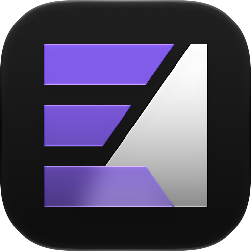
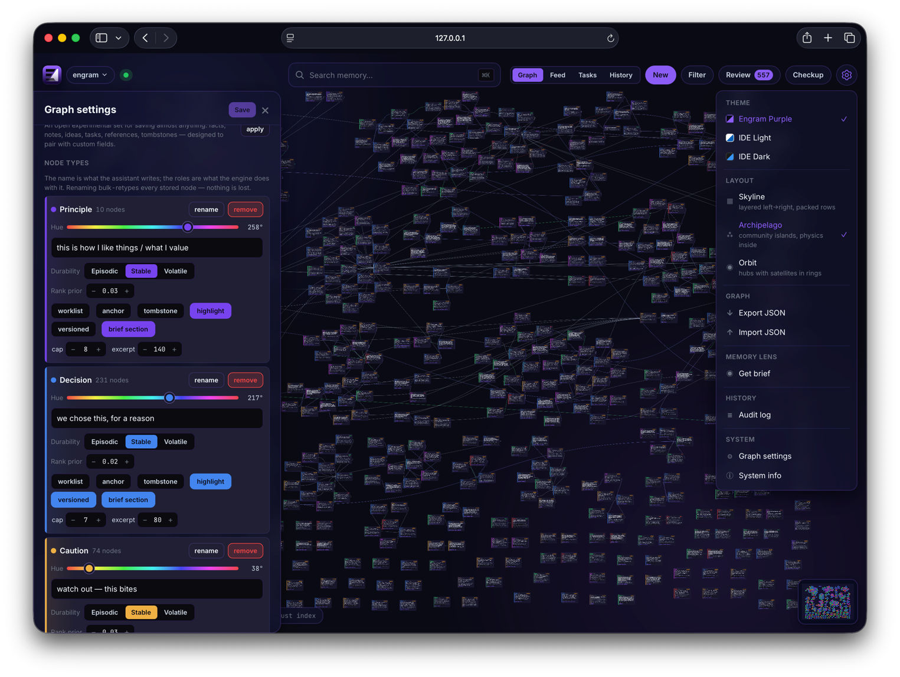
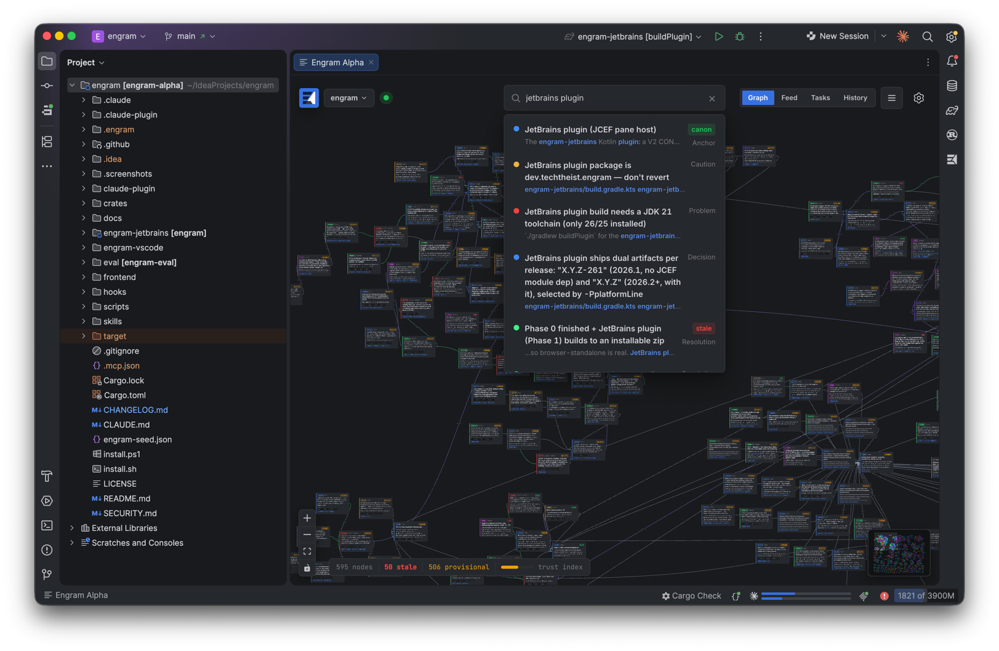
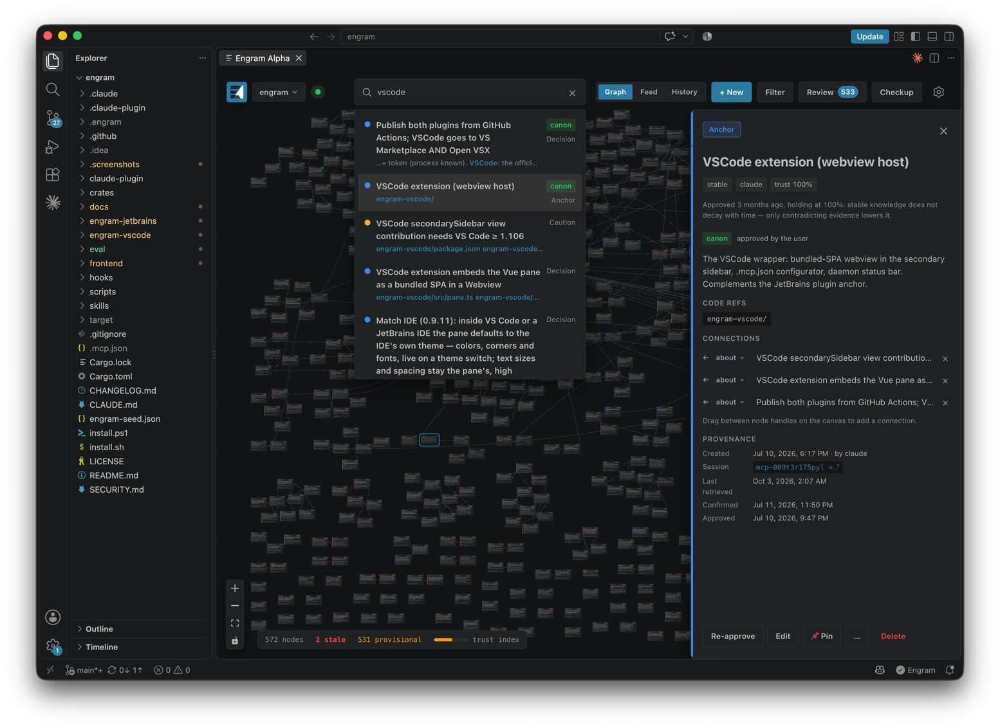
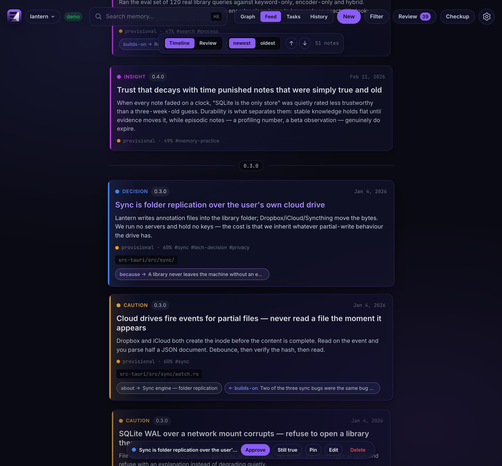

# Engram Alpha

[](https://github.com/techtheist/engram/actions/workflows/backend.yml)
[](https://github.com/techtheist/engram/actions/workflows/frontend.yml)
[](https://github.com/techtheist/engram/actions/workflows/jetbrains.yml)
[](https://github.com/techtheist/engram/actions/workflows/vscode.yml)
[](https://plugins.jetbrains.com/plugin/32654-engram)
[](https://plugins.jetbrains.com/plugin/32654-engram)
[](https://marketplace.visualstudio.com/items?itemName=techtheist.engram-alpha)
[](https://open-vsx.org/extension/techtheist/engram-alpha)
[](https://open-vsx.org/extension/techtheist/engram-alpha)

<p align="center">

</p>

> The most feature-rich inspectable long-term graph memory for software development with AI agents — built on reproducible research.

Your AI assistant forgets everything between sessions: why you picked this
library, which approach already failed, what's still unfinished. Engram
remembers it for them. It keeps the **reasoning behind your project** as a
graph your assistant reads before it acts and adds to as it works, and that
you can see, edit, and own. It is one file inside your repo, every model it
uses runs on your machine, and one memory serves every assistant you use.

**[Open the live demo →](https://techtheist.github.io/engram/demo/)**



<details>
<summary><b>Inside JetBrains IDEs</b> <i>(click to expand)</i></summary>
<br>


</details>

<details>
<summary><b>Inside VS Code</b> <i>(click to expand)</i></summary>
<br>


</details>

<details>
<summary><b>The timeline feed</b> <i>(click to expand)</i></summary>
<br>


</details>

## When Engram helps, and when a notes file is enough

A `CLAUDE.md` or `AGENTS.md` file is a fine memory for a small project: the
assistant reads the whole thing every session, and nothing gets lost. It
stops working as the project's history grows:

- **It gets too long to read.** A file the assistant loads every session has
  to stay short. In our benchmarks a 3,000-token notes file holds up to about
  40 notes and loses to search by 100; even a very diligent 30,000-token one
  falls apart past ~200. Engram searches instead and hands over only what the
  task needs: about 300 tokens per question at 1,500 notes.
- **Old decisions linger.** When you change your mind, the old line in the
  file keeps contradicting the new one. In Engram the new decision
  **replaces** the old one, and the old one leaves search results while
  staying in history.
- **Contradictions hide.** Engram checks each new note against what's
  already there and flags conflicts for you or the assistant to decide.
- **Removed things come back.** A deliberately dropped feature or idea leaves
  a Tombstone, so no later session suggests it again.
- **Every assistant needs its own file.** One Engram graph serves Claude
  Code, Codex, Cursor and the rest at once.

So: under a few dozen decisions, keep the notes file. Once the project has a
history, with changed minds, gotchas, and more than one assistant, Engram is
the memory that keeps up.

<details>
<summary><b>What makes the graph different</b> <i>(click to expand)</i></summary>

The graph is *active*: replaced knowledge is archived behind a `replaces`
edge, look-alike claims are flagged and judged, contradictions become visible
`conflicts-with` edges, and trust fades on scratch nobody re-confirmed while
pinned decisions never fade. The payoff shows up the second time something
goes wrong: the graph already holds the **Problem**, the **Resolution** that
answered it, and the **Caution** that would have prevented it.

- **Local-first.** Your memory is a file inside your repo. Embeddings and
  every scan run on your machine: no cloud, no keys, fully offline. Portable
  via JSON export, not a binary blob.
- **One memory, every agent.** The core speaks MCP, so **Claude Code, Codex
  (CLI and desktop app), Gemini CLI, OpenCode, Kilo, Google Antigravity, Bob
  (IDE and Shell), Windsurf, Devin CLI, and Cursor** share the same per-repo graph.
  A decision captured by one assistant is recalled by the next.
- **Graph-first.** The graph is the product surface, not hidden plumbing.
  Reviewing, judging, and repairing memory all happen in the pane — in the
  browser, in JetBrains IDEs, or in VS Code.

</details>

## Install

```sh
curl -fsSL https://raw.githubusercontent.com/techtheist/engram/main/install.sh | sh
```

The installer fetches the binary and nothing else. From your project's root:

```sh
engram-alpha setup    # wires the assistants it finds (--cli names the ones you want)
engram-alpha serve    # starts the core; the pane is at http://127.0.0.1:8787
```

<details>
<summary><b>Other ways to install</b> <i>(IDE plugins, the Claude Code plugin, Windows, per-assistant wiring — click to expand)</i></summary>

Or skip the browser and open the pane inside your IDE with the
[JetBrains plugin](https://plugins.jetbrains.com/plugin/32654-engram) or the
[VS Code extension](https://marketplace.visualstudio.com/items?itemName=techtheist.engram-alpha).
Claude Code users can install everything as a plugin:
`/plugin marketplace add techtheist/engram`. Windows, per-assistant wiring,
and updating: [Getting started](./docs/getting-started.md).

</details>

## What you get

- **A graph you can read and edit** — three layouts, tags and filters,
  editing by hand, and a timeline view of the same memory. Only you can
  hard-delete. → [The pane](./docs/pane.md)
- **An assistant that starts briefed** — every session opens with a short
  digest: conflicts to settle, open work, standing decisions. During the
  session it searches before it decides, and each result arrives with the
  notes that contradict or replaced it. → [Recall & capture](./docs/recall-and-capture.md)
- **Quiet writing, checked writing** — the assistant saves without chatter,
  and every save is checked: duplicates merge, and a save that lands near
  replaced, disputed, or deliberately removed knowledge gets a warning. You
  approve what you vouch for. → [Recall & capture](./docs/recall-and-capture.md)
- **A memory that argues back** — a small local model checks new claims
  against what the graph already says, and sweeps for hidden conflicts and
  duplicates. The model only nominates; you or your assistant decide.
  → [Conflicts & Checkup](./docs/conflicts-and-checkup.md)
- **Search that admits when it doesn't know** — every answer says how sure
  it is (`strong` / `weak` / `none`), so the assistant says "I don't have
  that" instead of making something up. Search can also be scoped in time
  ("last week", a release). → [Measured, not promised](#measured-not-promised)
- **Trust you can follow** — a note gains trust only when someone confirms
  it, never just from being read; old scratch fades, and only you can pin.
  → [Trust & decay](./docs/trust.md)
- **Every change on the record** — an append-only audit journal with
  before/after values and session attribution, where any change — or
  everything one session wrote — can be undone after a preview; and an
  optional sealed recording of your assistant sessions that search can fall
  through to.
  → [The pane](./docs/pane.md)
- **Memory that tracks the code** — nodes point at code; refs that stop
  resolving badge their nodes as drifted, with a repair-or-retire contract.
  → [Recall & capture](./docs/recall-and-capture.md)
- **A model you can reshape** — the ontology, the trust and decay numbers,
  custom fields, and the brief are per-graph configuration edited in one
  Settings drawer, with curated presets. → [Customization](./docs/customization.md)
- **One memory across your projects** — one core process, a machine
  registry, and a home graph for knowledge that was never project-scoped.
  → [Multi-project memory](./docs/multi-project.md)
- **Storage and models you choose** — graphs live on a single
  self-describing [TepinDB](https://github.com/tepindb/tepindb) file (SQLite
  graphs migrate themselves, at-rest encryption is a switch); embeddings,
  reranker, and NLI are swappable from the pane.
  → [Storage](./docs/storage.md) · [Local models](./docs/models.md)

<details>
<summary><b>The memory model</b> <i>(node types, edge verbs, capture intensities — click to expand)</i></summary>

Nine node types — Principle, Decision, Caution, Problem, Resolution,
Insight, Intent, Anchor, Tombstone — and seven edge verbs that read as
sentences: a Decision **because** a Principle, a Resolution **answers** a
Problem, the newer **replaces** the older, two claims **conflict-with** each
other. Three capture intensities (`relaxed` / `normal` / `aggressive`) set
how much your assistant writes. It's the shipped default, and the one most
projects should keep — but every part of it is
[yours to reshape](./docs/customization.md). → [The memory model](./docs/memory-model.md)

</details>

## Measured, not promised

Engram ships its own offline benchmark. It asks about invented subjects no
model could know from training, grades answers without an LLM judge, and
reruns identically from a seed. Since 0.8.0 every retrieval default is the
output of a run published next to the code.

- **~9× less text for the same answers.** At 1,500 realistic notes, Engram
  finds the answer in ~300 tokens per question where plain vector search
  needs ~2,700, at equal recall@5 and slightly ahead overall (0.93 vs 0.91).
- **Where a maintained memory file loses, measured.** A 3,000-token
  CLAUDE.md is whole below ~40 notes and overtaken by retrieval at 100; an
  unusually diligent 30,000-token one wins up to ~200 notes, then falls off
  its capacity cliff by 500.
- **Attention metrics, not just recall.** Every table pairs recall with
  `focus` (how much of the delivery was the answer) and `noise` (how much
  was false positives). A full-context dump scores recall 1.00 and focus
  0.004 on the same run — *present* and *readable* are different claims.
- **Supersession works, with an ablation.** On re-decided ADR-shaped
  history the shipped stack delivers **zero** retired generations; the same
  store without supersession delivers one on 88% of questions.
- **Tested on an external corpus.** [LongMemEval](./eval/LONGMEMEVAL.md)
  (real multi-session chats, MIT) runs as-is under a chat ontology defined
  purely as data: rag's recall@1 matched at 8% of its delivered tokens, and
  the 30 never-answerable questions drew **zero** confident answers.
- **What didn't work stays on the record** — spreading activation, a
  deciding cross-encoder, deeper reranking — because a benchmark that only
  reports wins is an advertisement.

Method, tables, and the honest caveats: [`eval/`](./eval/README.md).

<details>
<summary><b>Documentation, security, and status</b> <i>(click to expand)</i></summary>

All user documentation lives in [`docs/`](./docs/README.md) — install and
wiring, the memory model, trust, the pane, conflicts, multi-project memory,
the [runtime architecture](./docs/runtime.md), storage, local models, and
troubleshooting (`engram-alpha doctor` diagnoses the whole chain,
`engram-alpha status` shows what's running, `engram-alpha stop` halts it).

Security posture: [`SECURITY.md`](./SECURITY.md). The roadmap lives in the
project's own memory graph — dogfooding is the spec.

</details>

<details>
<summary><b>Benchmark results</b> <i>(click to expand)</i></summary>

1,883 notes, 9,008 tasks, from https://github.com/techtheist/knowledgedrift:

| system                                                       | success | families | signal | tokens | **score** | tok / answer |
|--------------------------------------------------------------|---------|----------|--------|--------|-----------|--------------|
| Engram Alpha                                                 | **69%** | **700**  | 32     | 69     | **801**   | ~460         |
| TF-IDF over titles, one snippet per answer (`tfidf`)         | 43%     | 442      | 37     | 100    | **580**   | ~160         |
| the whole file in context                                    | 71%     | 390      | 0      | 0      | **390**   | ~404,000     |
| MemContinuum 0.2.0rc5 (topics + `for-path` chains)           | 44%     | 326      | 7      | 47     | **380**   | ~840         |
| Supermemory local 0.0.8 (no LLM: direct memories, versioned) | 48%     | 345      | 8      | 12     | **364**   | ~2,200       |
| vector top-k (`rag`)                                         | 48%     | 340      | 7      | 11     | **359**   | ~2,200       |
| LangMem 0.0.30 (store + semantic index)                      | 48%     | 340      | 7      | 11     | **359**   | ~2,200       |
| Mem0 2.0.20 (`infer=False`)                                  | 44%     | 333      | 6      | 8      | **348**   | ~2,400       |
| keyword overlap (`grep`)                                     | 41%     | 315      | 6      | 3      | **325**   | ~2,800       |
| cognee 1.5.4 (no LLM: chunk store)                           | 43%     | 240      | 8      | 16     | **263**   | ~1,900       |
| chance                                                       | 3%      | 103      | 0      | 9      | **112**   | ~2,300       |
| a curated 3,000-token file                                   | 5%      | 108      | 0      | 1      | **109**   | ~2,960       |

</details>

<details>
<summary><b>Stack</b> <i>(Rust core, Vue pane, IDE hosts — click to expand)</i></summary>

- **Core — Rust.** One `engram-alpha` binary: the engine, the MCP server
  (`rmcp`, stdio and streamable HTTP), the HTTP API (`axum`), and the CLI.
  Storage on [TepinDB](https://github.com/tepindb/tepindb) (SQLite +
  `sqlite-vec` behind the same trait for older graphs). Local ONNX models
  through `fastembed` — embeddings, cross-encoder reranker, NLI — all
  user-swappable. No LLM ever runs in the core.
- **Pane — Vue 3 + TypeScript.** Vite and Bun, Pinia, Tailwind 4,
  [Vue Flow](https://vueflow.dev/) for the graph. Built once, embedded into
  the binary, and shared by every host below.
- **IDE hosts.** A JetBrains plugin (Kotlin, JCEF) and a VS Code extension
  (TypeScript, Webview) that embed the same pane and talk to the local core.
  A Claude Code plugin carries the MCP wiring and the capture skill.

</details>

## License

[MIT](./LICENSE)
